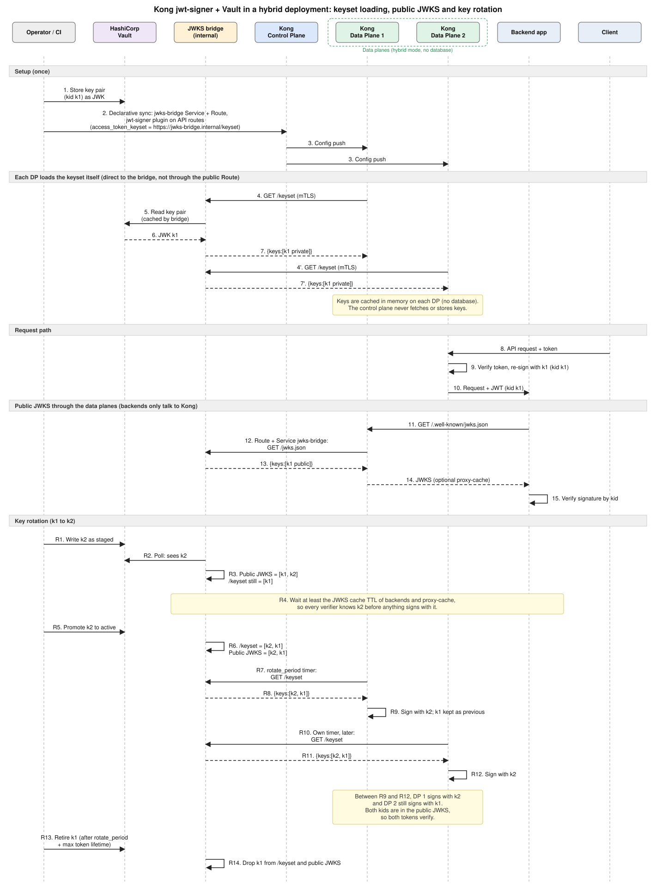

# jwt-signer-vault-jwks-bridge (jwks-bridge) — Design

Status: M1–M3 implemented. Date: 2026-10-19.

## Purpose

Let the Kong Gateway Enterprise `jwt-signer` plugin sign JWTs with a key pair stored in HashiCorp Vault, and let backend apps verify those JWTs through a JWKS endpoint served by Kong.

`jwks-bridge` is a small stateless Go REST service. It reads key pairs from a secret store, caches them in memory, and serves two documents:

| Document | Consumer | Content |
|---|---|---|
| Keyset (private) | Kong data planes | `{"keys":[…]}` with private JWK parameters |
| JWKS (public) | Backend apps, through a Kong Route | `{"keys":[…]}` with public parameters only |

## Why a bridge is needed

Facts below come from `kong-ee` (`master`), `kong/plugins/jwt-signer/` and `kong/openid-connect/`. They were read from source, not tested on a live deployment.

| Fact | Consequence | Source |
|---|---|---|
| `access_token_keyset` is a keyset name or an `https://` URL. | An external signing key can only be supplied by URL. | `cache.lua:248-250`, `cache.lua:309-327` |
| The URL response must have a top-level `keys` array. Private JWK fields (`d`, `p`, `q`, `dp`, `dq`, `qi`) are kept. | The endpoint must return a JWKS that includes private parameters. | `openid-connect/keys.lua:188-190`, `daos.lua` |
| Vault KV v2 wraps secrets as `{data:{data:…}}`. Vault's OIDC `/.well-known/keys` returns public keys only. | Neither can be used as the keyset URL. | Vault API behavior |
| `jwt_signer_jwks` has no Admin API write route. Only `GET`, `DELETE` and `/rotate` exist. | A Vault key can't be pushed into the default `kong` keyset. | `api.lua:109-241` |
| `GET /jwt-signer/jwks/<name>` strips private fields and exists only on the Admin API. | There is no public JWKS endpoint on data planes. | `api.lua:38-57`, `api.lua:177-198` |
| In hybrid mode data planes have no database. Keys are cached in memory per data plane. | The `kong` keyset would produce a different key pair on each data plane. An external keyset is the only consistent option. | `cache.lua:211-220` |
| Only `*_keyset_client_username/password` are `referenceable` (Kong Vault references). | Kong cannot read key material from Vault itself. | `schema.lua:108-118` |
| Signing uses the first key matching `access_token_signing_algorithm` in the current set. Previous keys are kept for verification. | The bridge must return the active key first, then older keys. | `keys.lua:324`, `handler.lua:1179-1180`, `cache.lua:158-170` |
| In Konnect mode, with signing on and an upstream header set, the keyset must be a valid URL. | The design works with Konnect hybrid. | `schema.lua:1225-1236` |

## Goals and non-goals

Goals:

- Vault KV v2 as the source of truth for signing key pairs.
- A pluggable secret-store interface so AWS Secrets Manager, GCP Secret Manager and Azure Key Vault can be added.
- In-memory caching with stale-if-error, so Vault outages do not stop signing or verification.
- Staged key rotation that is safe with several data planes rotating on independent timers.
- Stateless replicas; no database.

Non-goals:

- Generating or rotating keys. Operators or CI write keys to Vault. A generate-and-write helper CLI can be added later.
- Vault Transit. Transit keys are non-exportable, and `jwt-signer` needs the private key material.
- Signing tokens. Kong signs.
- Acting as an OIDC provider or OAuth server.

## Architecture



Components:

| Component | Role |
|---|---|
| Vault | Stores the key pairs. |
| jwks-bridge | Reads Vault, caches, serves keyset and public JWKS. Run two or more replicas. |
| Kong control plane | Holds the config: Service and Route for the public JWKS, `jwt-signer` plugin with the keyset URL. Never fetches keys. |
| Kong data planes | Fetch `/keyset` directly from the bridge, sign tokens, proxy `/.well-known/jwks.json` to the bridge. |
| Backend apps | Fetch the public JWKS through a data plane only. |

Routing rule:

- `/.well-known/jwks.json` is exposed through a Kong Route and Service so backends only talk to Kong.
- `/keyset` is not routed through Kong. It returns private keys, and a data plane fetching its own keys through itself is circular. Data planes call it directly on the internal network with mTLS.

## API

Two listeners, so the private endpoint never shares a port with the public one.

| Listener | Default | Auth | Endpoints |
|---|---|---|---|
| public | `:8080` (HTTP, TLS optional) | none | `GET /jwks.json`, `GET /.well-known/jwks.json`, `GET /healthz`, `GET /readyz` |
| private | `:8443` (TLS required) | mTLS (client cert allowlist) or Basic auth | `GET /keyset` |
| admin | `:9090` | none, bind to localhost or cluster-internal | `GET /metrics` |

Keyset names: one bridge serves several keysets with `?name=<keyset>` on both endpoints (default `default`). Each keyset maps to one Vault secret path.

Responses:

- `Content-Type: application/jwk-set+json`.
- `ETag` on both endpoints; `If-None-Match` returns `304`.
- Public JWKS: `Cache-Control: public, max-age=<jwks_max_age>` (default 300 s).
- Keyset: `Cache-Control: no-store`.
- Errors: `404` unknown keyset, `401/403` auth failure on private listener, `503` if no valid snapshot has ever loaded.

`/keyset` constraints from the plugin:

- The URL must be `https://` when `access_token_endpoints_ssl_verify` is on. Use a certificate the data plane trusts, or add the CA as a Kong certificate.
- The plugin sends client credentials as HTTP Basic or presents a Kong `certificates` entity (`access_token_keyset_client_username/password`, `access_token_keyset_client_certificate`).

## Vault storage model

KV v2 path per keyset, for example `secret/jwks-bridge/default`. The secret holds one field `keys` (JSON array):

```json
{
  "keys": [
    {
      "kid": "2026-10-k2",
      "status": "active",
      "promoted_at": "2026-10-19T09:00:00Z",
      "jwk": { "kty": "RSA", "alg": "RS256", "use": "sig", "kid": "2026-10-k2",
               "n": "…", "e": "AQAB", "d": "…", "p": "…", "q": "…",
               "dp": "…", "dq": "…", "qi": "…" }
    }
  ]
}
```

States:

| Status | In public JWKS | In `/keyset` | Position in `/keyset` |
|---|---|---|---|
| `staged` | yes | no | n/a |
| `active` | yes | yes | first for its `alg` |
| `retired` | yes, until removed | yes, until removed | after `active` |

Removing an entry from Vault removes it from both documents.

Validation on every load (a snapshot that fails is rejected and the last good one is kept):

- `kid` unique and non-empty; `jwk.kid` equals `kid`.
- `jwk.alg` set and one of the algorithms `jwt-signer` accepts: `RS256`, `RS512`, `ES256`, `ES384`, `ES512`, `PS256`, `PS384`, `PS512`, `EdDSA` (the `access_token_signing_algorithm` list in `schema.lua:444-458`, minus `HS*`; symmetric keys never go in a public JWKS).
- Active entries carry private parameters; the key pair is consistent (derive the public key from the private key and compare).
- At most one `active` entry per `alg`.
- At least one `active` entry per keyset.

Public derivation: copy the JWK and drop `d`, `p`, `q`, `dp`, `dq`, `qi`, `k`, `oth`.

## Secret-store interface

```go
type Source interface {
    // Load returns the raw keyset for name and a version token (for example the KV v2 version).
    Load(ctx context.Context, name string) (KeySet, string, error)
    // Ping checks connectivity for /readyz.
    Ping(ctx context.Context) error
}
```

Implementations, in order:

1. `vault` (KV v2).
2. `file` (directory of JSON files, for tests and local demos).
3. `awssm`, `gcpsm`, `azurekv` later.

Vault authentication: Kubernetes auth (default in clusters), AppRole, or a static token for development. Token renewal uses the Vault client's lifetime watcher. The Vault policy grants `read` on the configured path and `read` on its `metadata` path only.

## Caching

- The cache holds one immutable snapshot per keyset: parsed keys, precomputed `/keyset` bytes, precomputed public JWKS bytes, ETags, source version, load time. Snapshots are swapped with `atomic.Pointer`, so request handlers never lock.
- A background refresher polls each keyset every `refresh_interval` (default 30 s, with ±10 % jitter). It reads the KV version first and skips the full parse when unchanged.
- Refreshes use `singleflight` per keyset.
- Stale-if-error: if Vault is unreachable, the last good snapshot keeps being served. `/readyz` reports ready while the snapshot is younger than `max_stale` (default 1 h) and not-ready afterwards. `/healthz` stays up.
- Cold start: `/readyz` is not ready until every configured keyset has loaded once. Liveness is not tied to Vault.
- Replicas cache independently. After a promotion, replicas can disagree for up to one `refresh_interval`. The rotation rules below absorb this.

## Rotation workflow

Rotation is a sequence of status changes in Vault. Key generation and Vault writes happen outside the bridge.

| Step | Action | Effect |
|---|---|---|
| 1 | Operator writes k2 with `status: staged` | k2 appears in the public JWKS only. |
| 2 | Wait at least `max(backend JWKS cache TTL, proxy-cache TTL, jwks_max_age) + refresh_interval` | Every verifier knows k2 before anything signs with it. |
| 3 | Operator sets k2 `active` and k1 `retired` | `/keyset` returns `[k2, k1]`; public JWKS returns `[k2, k1]`. |
| 4 | Each data plane reloads on its own `access_token_keyset_rotate_period` timer | A data plane signs with k2 after its reload. Until then it signs with k1. |
| 5 | Wait at least `rotate_period + max token lifetime + clock skew` | No data plane signs with k1 and no live token carries k1. |
| 6 | Operator removes k1 | k1 leaves both documents. |

Properties:

- Data planes switch from k1 to k2 at different times. Both kids are in the public JWKS throughout, so tokens from both verify.
- `jwt-signer` keeps each data plane's previous key set for verifying inbound tokens, so a data plane that already moved to k2 still accepts older tokens it issued.
- Safety guard: the bridge refuses to treat a key as `active` until `now - staged_at >= min_stage_duration` (default 10 min). It keeps the previous active key first until then and logs a warning. `staged_at` is recorded in the Vault entry by the writer.
- Verified in source: auto-rotation runs only on data planes, on worker 0, and the keyset is reloaded with `force=true`; the control plane never rotates (`auto_rotate.lua`). The Admin API `POST /jwt-signer/jwks/:name/rotate` is not usable in hybrid mode because the control plane holds no keys.

Emergency revoke: remove the compromised key from Vault. Public JWKS drops it after the next refresh and backend cache expiry. Data planes drop it after their next reload. Tokens signed with it stay valid on any verifier that still has it cached until their cache expires.

## Kong configuration

Declarative example (decK style). Field names `access_token_keyset`, `access_token_issuer`, `access_token_signing`, `access_token_signing_algorithm`, `access_token_upstream_header`, `access_token_keyset_rotate_period` and `access_token_endpoints_ssl_verify` were confirmed in `schema.lua`. Check the remaining plugin fields against your Kong version.

```yaml
_format_version: "3.0"
services:
  - name: jwks-bridge-public
    url: http://jwks-bridge.jwks.svc:8080
    routes:
      - name: jwks
        paths: ["/.well-known/jwks.json"]
        strip_path: false
        methods: ["GET"]
    plugins:
      - name: proxy-cache
        config:
          strategy: memory
          response_code: [200]
          content_type: ["application/jwk-set+json"]
          cache_ttl: 300

  - name: orders-api
    url: http://orders.backend.svc:8080
    routes:
      - name: orders
        paths: ["/orders"]
    plugins:
      - name: jwt-signer
        config:
          access_token_issuer: https://api.example.com
          access_token_jwks_uri: https://idp.example.com/.well-known/jwks.json  # verifies the inbound token
          access_token_signing: true
          access_token_signing_algorithm: RS256
          access_token_upstream_header: Authorization:Bearer
          access_token_keyset: https://jwks-bridge.jwks.svc:8443/keyset?name=default
          access_token_keyset_rotate_period: 300
          access_token_endpoints_ssl_verify: true
          access_token_keyset_client_username: "{vault://env/jwks-bridge-user}"
          access_token_keyset_client_password: "{vault://env/jwks-bridge-pass}"
```

The `iss` claim of re-signed tokens is `access_token_issuer`. Backends validate `iss` and `kid` against `https://<kong-proxy>/.well-known/jwks.json`.

## Security

| Threat | Mitigation |
|---|---|
| Private keys exposed on the public listener | Separate listener and port; private routes registered only on the TLS listener; a test asserts no private parameter appears in any public response. |
| Unauthorized `/keyset` caller | mTLS with a client certificate allowlist (subject or SAN), or Basic auth with constant-time comparison; network policy limiting callers to Kong data planes. |
| Keys in logs | Structured logging with an allowlist of fields. Keys are never logged. |
| Vault credentials leak | Kubernetes auth with short-lived tokens; read-only policy on one path. |
| Compromised replica | Same exposure as the Vault read policy; per-keyset paths limit blast radius. |
| Memory exposure | Distroless, non-root, read-only filesystem; no core dumps. |
| Vault outage | Stale-if-error with `max_stale`; alert on snapshot age. |
| Replica disagreement after promotion | `min_stage_duration` much larger than `refresh_interval`. |

## Observability

Prometheus metrics on the admin listener:

- `jwksbridge_snapshot_age_seconds{keyset}`
- `jwksbridge_refresh_total{keyset,result}`
- `jwksbridge_keys{keyset,status}`
- `jwksbridge_requests_total{endpoint,code}`
- `jwksbridge_request_duration_seconds{endpoint}`
- `jwksbridge_source_errors_total{source}`

Alerts: snapshot age above `max_stale / 2`; refresh failures for 5 minutes; zero `active` keys; any non-2xx rate on `/keyset`.

Tracing: OpenTelemetry with the W3C Trace Context and Baggage propagators. The public and private listeners continue an inbound `traceparent`; Vault calls carry it on; each refresh is a `keyset.refresh` span. Spans are exported only when `OTEL_EXPORTER_OTLP_ENDPOINT` (or another `OTEL_*` exporter variable) is set.

## Configuration

Environment variables and flags (flags win):

| Setting | Default | Description |
|---|---|---|
| `JWKSB_PUBLIC_ADDR` | `:8080` | Public listener |
| `JWKSB_PRIVATE_ADDR` | `:8443` | Private TLS listener |
| `JWKSB_ADMIN_ADDR` | `:9090` | Metrics listener |
| `JWKSB_TLS_CERT` / `JWKSB_TLS_KEY` | none | Server certificate for the private listener |
| `JWKSB_CLIENT_CA` | none | CA bundle for mTLS client verification |
| `JWKSB_ALLOWED_CLIENT_SANS` | none | Comma-separated SAN allowlist |
| `JWKSB_BASIC_USER` / `JWKSB_BASIC_PASSWORD_FILE` | none | Optional Basic auth |
| `JWKSB_SOURCE` | `vault` | `vault` or `file` |
| `JWKSB_KEYSETS` | `default=secret/jwks-bridge/default` | `name=path` pairs |
| `JWKSB_REFRESH_INTERVAL` | `30s` | Poll interval |
| `JWKSB_MAX_STALE` | `1h` | Readiness cutoff |
| `JWKSB_JWKS_MAX_AGE` | `300s` | Public `Cache-Control` max-age |
| `JWKSB_MIN_STAGE_DURATION` | `10m` | Guard before a staged key may become active |
| `VAULT_ADDR`, `VAULT_NAMESPACE`, `JWKSB_VAULT_AUTH`, `JWKSB_VAULT_ROLE` | none | Vault connection and auth method |

## Project layout

```
jwt-signer-vault-jwks-bridge/
  DESIGN.md
  cmd/jwks-bridge/        serve, keygen, validate, version
  internal/config/        flags and JWKSB_* environment
  internal/keyset/        parse, validate, derive public, render, staging guard
  internal/keygen/        key pair generation as keyset entries
  internal/source/        Source interface, vault/, file/
  internal/cache/         snapshots, refresher, singleflight
  internal/server/        public, private, admin handlers, auth, TLS reload
  internal/metrics/       Prometheus collectors
  internal/telemetry/     OpenTelemetry setup, W3C propagation
  deploy/helm/jwks-bridge Helm chart
  examples/               local, vault, kubernetes, kong
  test/e2e/               kind: Vault, bridge, Kong hybrid (1 CP, 2 DPs); Go tests
  docs/                   GitHub Pages site (docs/docs/*.html), diagram
  scripts/site.py         keeps the site's shared parts in sync and checks links
```

Libraries: standard `net/http` mux, `github.com/hashicorp/vault/api`, `github.com/go-jose/go-jose/v4`, `github.com/prometheus/client_golang`, `golang.org/x/sync/singleflight`, OpenTelemetry (`otelhttp`, `autoexport`).

## Deployment

- Container image: distroless, non-root, read-only root filesystem.
- Kubernetes: two or more replicas, PodDisruptionBudget, `readinessProbe` on `/readyz`, `livenessProbe` on `/healthz`, NetworkPolicy allowing `:8443` only from Kong data plane pods and `:8080` only from Kong data planes.
- Run the bridge in the same network zone as the data planes. The control plane needs no route to it.

## Testing

| Level | What |
|---|---|
| Unit | Parse and validate keysets; public derivation never leaks private fields; ordering of `/keyset`; state transitions and `min_stage_duration`. |
| Cache | Stale-if-error, `max_stale` readiness, ETag and `304`, singleflight under concurrent refresh. |
| Source | Vault KV v2 against a Vault dev server; Kubernetes and AppRole auth paths with a mocked login. |
| End to end | kind cluster with Vault (Kubernetes auth), the bridge (Helm chart) and Kong Gateway Enterprise in hybrid mode (one control plane, two data planes). Assert: both data planes sign with the same `kid`; the token verifies against the Route-served JWKS; a full k1 to k2 rotation never causes a verification failure under continuous traffic. `test/e2e/run.sh`. |

## Open questions

Verified by the end-to-end test on Kong Gateway Enterprise 3.14.0.16 (2026-10-19):

- Two database-less data planes each reload the URL keyset on their own `access_token_keyset_rotate_period` timer; a k1 to k2 rotation under traffic produced no verification failure.
- A keyset URL with a query string (`/keyset?name=default`) works, with Basic auth and `access_token_endpoints_ssl_verify: true`.
- `access_token_keyset_rotate_period: 20` is honoured: both data planes switched keys within one period of the promotion.
- Routes created through the Admin API without `protocols` came back as `["https"]` on 3.14; set `protocols` on the public JWKS Route when it is served over HTTP.

Not verified yet:

- Behavior when `/keyset` returns several active keys with the same `alg` (the design forbids it).
- Konnect-managed data planes: confirm the keyset URL is reachable and that `access_token_keyset_client_certificate` works with Konnect-managed certificates.
- Whether the `keygen` command should also write to Vault, replacing `examples/vault/rotate.sh`.

## Milestones

| Milestone | Scope |
|---|---|
| M1 | `file` and `vault` sources, keyset validation, public and private endpoints, in-memory cache, metrics. |
| M2 | mTLS and Basic auth, rotation guard, Docker image, Kubernetes manifests. |
| M3 | End-to-end tests with Kong hybrid, rotation test under load. |
| M4 | Additional sources (AWS Secrets Manager, GCP Secret Manager, Azure Key Vault), key generation CLI. |
